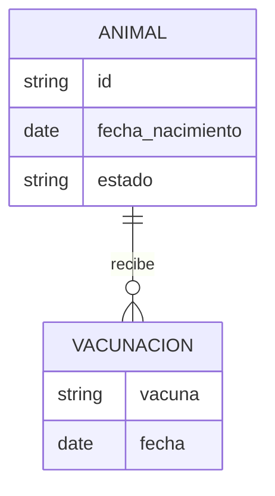
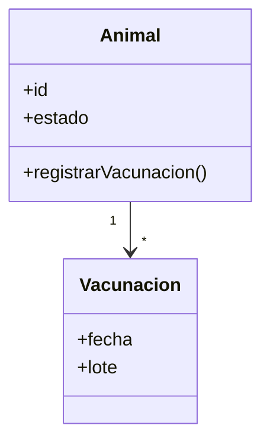
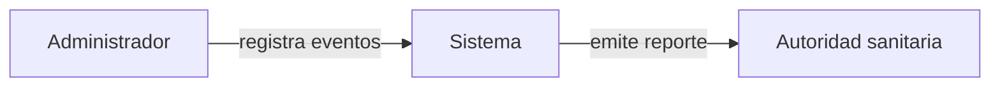
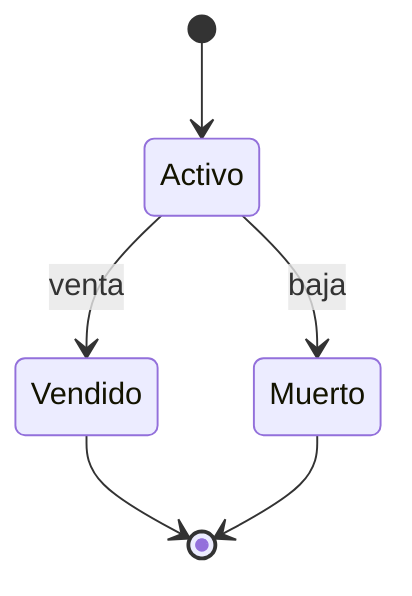
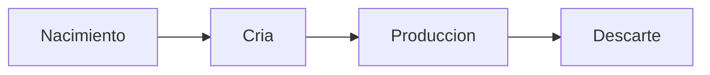
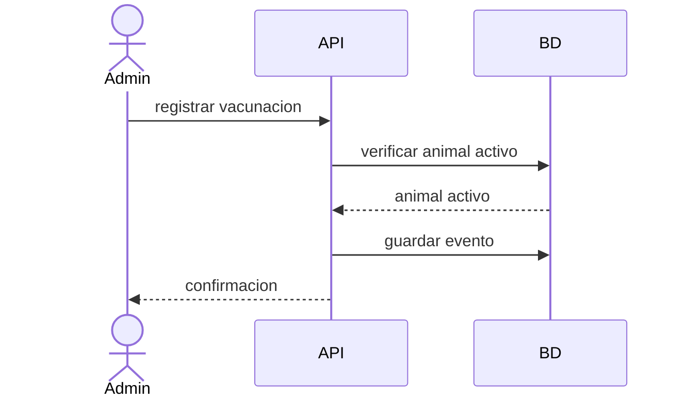
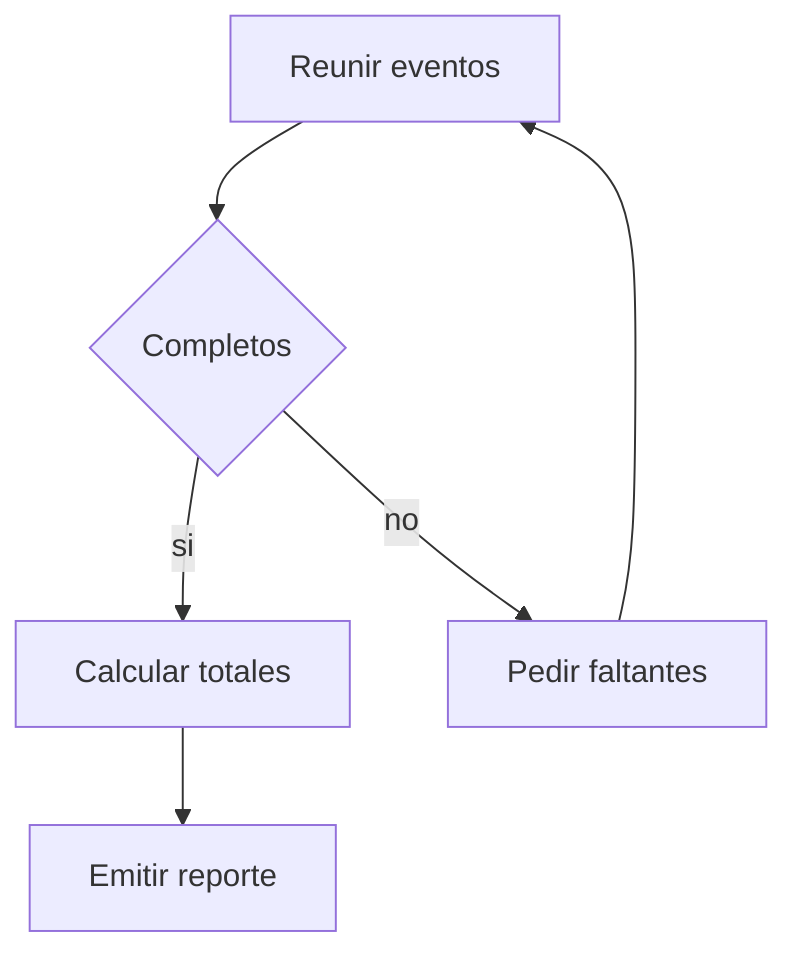
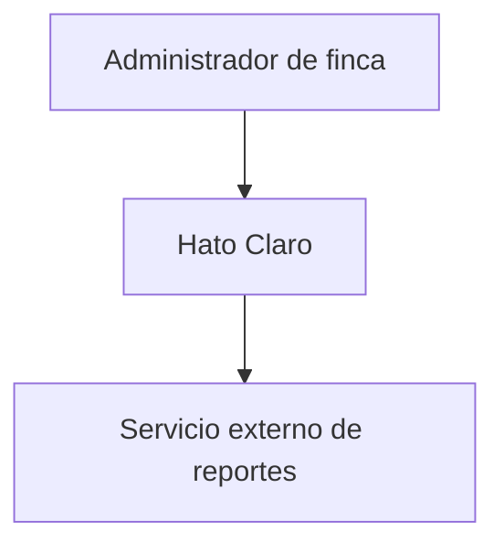

# Catálogo de diagramas

Ocho tipos. Para cada uno: cuándo es pertinente, cuándo se descarta, esqueleto Mermaid. Un diagrama por archivo `.mmd`, nombrado como indica cada tipo.

## Reglas de sintaxis Mermaid (todas las plantillas)

- Sin `;` en etiquetas, notas ni mensajes (Mermaid lo toma como separador de sentencia).
- Miembros de clase sin corchetes ni paréntesis, salvo los métodos (`+registrar()`); tipos genéricos como `ListaAnimal`, no `List<Animal>`.
- Un diagrama por archivo `.mmd`: nunca mezcles dos bloques de diagrama en el mismo archivo.
- Identificadores sin espacios ni acentos (`AdminFinca`); el texto con espacios va entre comillas dentro de la etiqueta.
- Etiquetas de aristas cortas; sin comillas dobles anidadas.
- Los archivos `.mmd` contienen solo código Mermaid, sin cercas ``` .

## 1. ER — `er.mmd`

- **Pertinente**: la spec define dos o más entidades persistidas con relaciones.
- **Se descarta**: hay una sola entidad o no hay persistencia.



## 2. Clases de dominio — `domain-classes.mmd`

- **Pertinente**: hay comportamiento y reglas de negocio en objetos del dominio, no solo datos.
- **Se descarta**: el dominio es solo datos tabulares (basta el ER) o el diseño no es orientado a objetos.



## 3. Actores y responsabilidades — `actors.mmd`

- **Pertinente**: hay dos o más actores (personas o sistemas) con responsabilidades distintas.
- **Se descarta**: un único usuario y ningún sistema externo.



## 4. Estados — `states.mmd`

- **Pertinente**: una entidad cambia de estado con transiciones y guardas (activo, vendido, muerto).
- **Se descarta**: ninguna entidad tiene ciclo de estados explícito.



## 5. Ciclo de vida — `lifecycle.mmd`

- **Pertinente**: el proyecto o un artefacto atraviesa etapas largas y ordenadas (por ejemplo, ciclo del animal o de un contrato) que no se capturan con estados simples.
- **Se descarta**: coincide con el diagrama de estados o es una sola etapa.



## 6. Secuencia del caso de uso central — `sequence-main.mmd`

- **Pertinente**: el caso de uso central involucra tres o más participantes o validaciones en orden.
- **Se descarta**: el caso de uso es una operación trivial de un solo participante.



## 7. Flujo del proceso crítico — `flow-critical.mmd`

- **Pertinente**: existe un proceso con pasos, decisiones y salidas (por ejemplo, cierre mensual).
- **Se descarta**: no hay proceso con ramificaciones.



## 8. Contexto C4 nivel 1 — `context-c4.mmd`

- **Pertinente**: el sistema interactúa con personas o sistemas externos (integraciones, autoridades, proveedores).
- **Se descarta**: sistema aislado sin actores externos relevantes.


